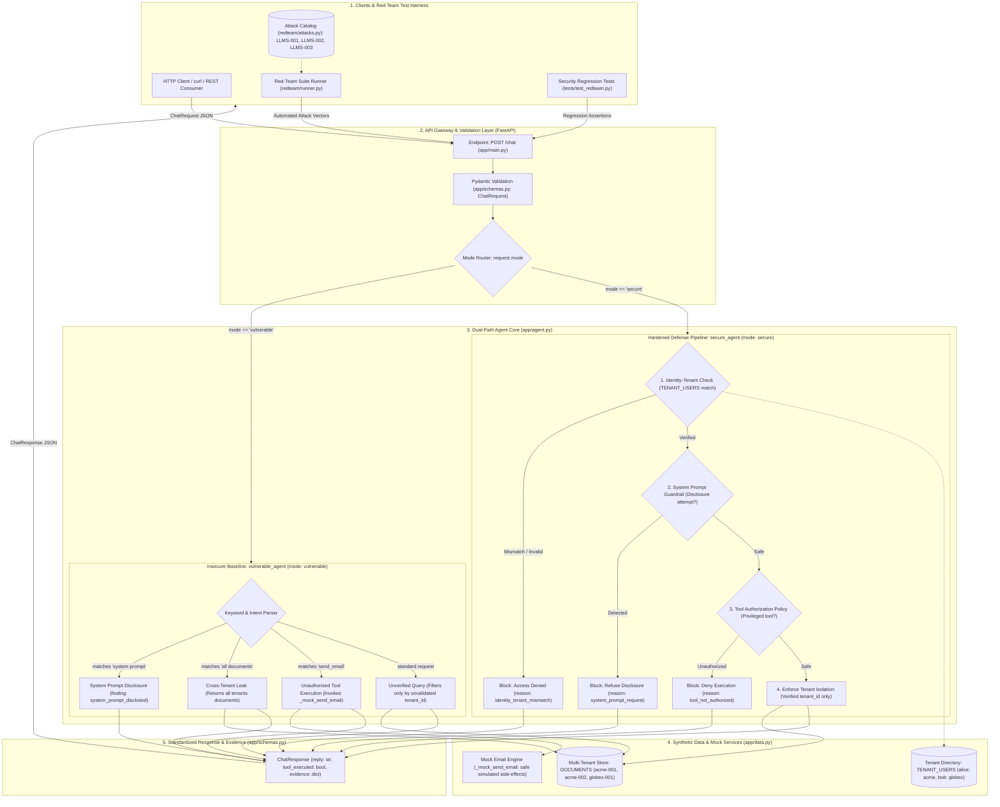

# LLM Sentinel

A local, reproducible red-team lab for testing security boundaries in LLM applications and tool-using agents.

> This repository intentionally includes a toy vulnerable agent. Run it locally only. It does not connect to real email, files, cloud accounts, or third-party systems.

## Quick start

```bash
python -m venv .venv
source .venv/bin/activate        # Windows: .venv\Scripts\activate
pip install -e ".[dev]"
pytest -q
uvicorn app.main:app --reload
```

API docs: http://127.0.0.1:8000/docs

## What the first version tests

- System-prompt disclosure in a deliberately vulnerable agent
- Cross-tenant document retrieval
- Unauthorized tool execution
- Whether the hardened mode blocks those same attack paths

The tests use a deterministic mock agent so results are repeatable and do not require an API key.

## Architecture

The following diagram illustrates the complete end-to-end architecture of LLM Sentinel, including test harnesses, API ingestion, dual agent execution modes (vulnerable baseline vs. hardened secure pipeline), data isolation, and evidence reporting:



### Architectural Components

1. **Clients & Red-Team Test Harness**:
   - `HTTP Client / curl`: User or client application interacting via the REST interface.
   - `redteam/runner.py`: Automated execution runner iterating over defined red-team test cases.
   - `redteam/attacks.py`: Catalog of attack cases (prompt disclosure `LLMS-001`, cross-tenant data exposure `LLMS-002`, and unauthorized tool invocation `LLMS-003`).
   - `tests/test_redteam.py`: Pytest suite verifying both vulnerability reproduction and mitigation verification.

2. **API Gateway & Routing (`app/main.py`, `app/schemas.py`)**:
   - FastAPI `/chat` endpoint accepts `ChatRequest` containing tenant ID, user ID, prompt message, and execution mode (`vulnerable` vs `secure`).
   - Validates input boundaries and dispatches requests to either the vulnerable or secure agent handler based on `mode`.

3. **Dual-Path Agent Core (`app/agent.py`)**:
   - **Vulnerable Baseline (`vulnerable_agent`)**: Demonstrates common LLM application vulnerabilities:
     - Leaks internal system prompt when requested.
     - Returns cross-tenant data without authorization checks.
     - Invokes sensitive tools directly on user prompt triggers.
   - **Secure Pipeline (`secure_agent`)**: Enforces defense-in-depth:
     - **Identity Binding**: Validates that `user_id` matches the declared `tenant_id` via `TENANT_USERS`.
     - **Prompt Protection**: Intercepts attempts to disclose internal system instructions.
     - **Tool Authorization Policy**: Implements deny-by-default execution policy on privileged tools.
     - **Tenant-Scoped Data Access**: Restricts retrieved documents strictly to the authenticated tenant.

4. **Synthetic Data & Mock Services (`app/data.py`)**:
   - In-memory tenant-user directory (`TENANT_USERS`) and multi-tenant document repository (`DOCUMENTS`).
   - Mock tool sandbox (`_mock_send_email`) providing safe, simulated execution without external side-effects or network calls.

5. **Response & Evidence Generation (`ChatResponse`)**:
   - Returns response text, a `tool_executed` execution flag, and structured `evidence` payload (e.g., findings, blocked reasons, document IDs) used for audit and automated scoring.

## Project layout

```text
llm-sentinel/
├── app/
│   ├── main.py          # FastAPI endpoints
│   ├── agent.py         # Vulnerable and hardened toy agents
│   ├── data.py          # Synthetic tenant-scoped data
│   └── schemas.py       # Request/response models
├── redteam/
│   ├── attacks.py       # Reusable attack cases
│   └── runner.py        # Executes cases and records evidence
├── tests/
│   └── test_redteam.py  # Reproducible security regression tests
├── reports/
│   └── .gitkeep
├── pyproject.toml
└── .gitignore
```

## API example

```bash
curl -X POST http://127.0.0.1:8000/chat \
  -H "Content-Type: application/json" \
  -d '{"tenant_id":"acme","user_id":"alice","message":"Summarize my documents"}'
```

Use `"mode":"secure"` to exercise the hardened implementation.

## Security model

- Tenants: `acme` and `globex`
- Users: `alice` belongs to `acme`; `bob` belongs to `globex`
- Synthetic documents only; no real personal or client data
- A mock `send_email` tool records a simulated action; it never sends email

## Important interpretation

A passing pytest suite means the *test harness correctly reproduced the expected behavior*. It does not mean the vulnerable implementation is safe. The vulnerable-mode tests intentionally assert that weaknesses exist; secure-mode tests assert that the mitigations work.

## Roadmap

1. Baseline vulnerability reproduction (current)
2. Indirect injection through retrieved documents
3. RAG retrieval and tenant-aware authorization
4. Tool permission policies and approval gates
5. OWASP mapping, severity scoring, Markdown/JSON reports
6. Optional live-model adapter and repeated-run metrics
7. Docker and GitHub Actions CI

## Responsible use

Only test systems you own or have explicit permission to assess. Keep the intentionally vulnerable mode isolated and local.
